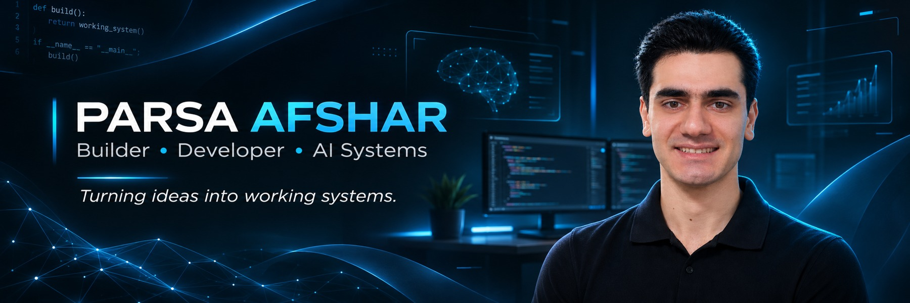
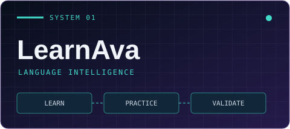
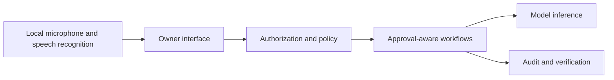
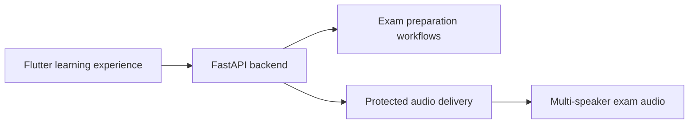
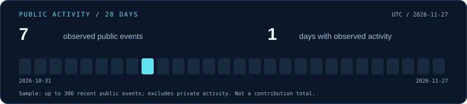

  

  <h3>Design systems. Build products. Make intelligence useful.</h3>

  
  
  

---

## 01 / About me

I'm **Parsa Afshar Fard**, a software developer and product builder exploring the intersection of intelligent systems, software engineering and real-world product development.

I like turning ambitious ideas into working systems: defining a problem, designing the architecture, building the product, and validating the result. My current work spans AI-assisted education, governed multi-agent workflows, local voice interfaces and engineering automation.

> Build with purpose. Validate with evidence. Keep improving.

## 02 / Systems I'm building

<table>
<tr>
<td width="50%" valign="top">

<h3>LearnAva / Zabanyar</h3>
An AI-assisted German-learning and exam-preparation product built with Flutter and FastAPI.
<ul>
<li>Cross-stack mobile and API development</li>
<li>Protected learner audio delivery</li>
<li>Multi-speaker exam audio and preparation workflows</li>
</ul>
<a href="https://github.com/parasaf1/engineering-showcase/blob/main/data/lernava.json">Public engineering evidence →</a>
</td>
<td width="50%" valign="top">

<h3>Extera / AI Company</h3>
A governed multi-agent platform with a dedicated SEVERUS owner-assistant experience.
<ul>
<li>Policy-controlled inference and task workflows</li>
<li>Local Windows microphone capture and speech recognition</li>
<li>Authorization boundaries, auditability and regression testing</li>
</ul>
<a href="https://github.com/parasaf1/engineering-showcase/blob/main/data/ai-company.json">Public engineering evidence →</a>
</td>
</tr>
</table>

Both products are in active development. Proprietary implementation remains private; the public showcase documents selected, sanitized engineering evidence and verification boundaries.

## 03 / Technology landscape

**Application & API**

  

**Web & product engineering**

  

**Systems & delivery**

  

## 04 / Engineering principles

| Principle | In practice |
| :--- | :--- |
| **Product first** | Start with a meaningful problem, not a technology checklist. |
| **Governed intelligence** | Explicit permissions, scoped tools and accountable AI workflows. |
| **Privacy by design** | Separate public evidence from proprietary source and user data. |
| **Evidence over claims** | Distinguish tested capabilities from work in progress. |
| **Continuous improvement** | Build, measure, validate and iterate. |

## 05 / Explore my work

[**Engineering Showcase**](https://github.com/parasaf1/engineering-showcase) — Public project documentation and evidence.

[**Live portfolio**](https://engineering-showcase-inky.vercel.app/) — A closer look at the projects, technical decisions and case studies.

[**Latest public project metadata**](https://github.com/parasaf1/engineering-showcase/tree/main/data) — The project's maintained public evidence source.

## 06 / Inside the systems

High-level maps of selected public engineering capabilities. These are conceptual views, not a disclosure of private implementation.

<b>EXTERA / Governed AI workflows</b>

Phase 14 includes validated local speech recognition and opt-in model inference; full autonomous operation and production readiness remain in progress. [Public evidence](https://github.com/parasaf1/engineering-showcase/blob/main/data/ai-company.json).

<b>LEARNAVA / AI-assisted language learning</b>

Selected validated exam preparation and audio capabilities. [Public evidence](https://github.com/parasaf1/engineering-showcase/blob/main/data/lernava.json).

## 07 / Public activity

Refreshed daily through GitHub Actions. This card samples public events only, not total contributions or private development activity.

  

---

  
  Built with curiosity, discipline and a bias toward execution.

