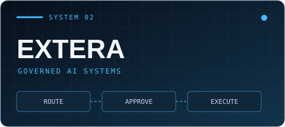
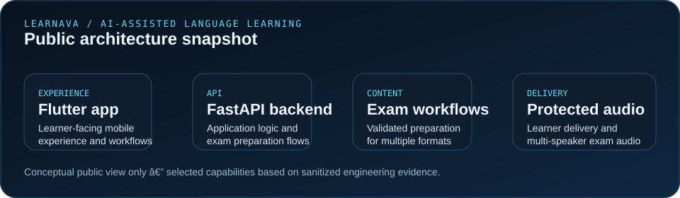
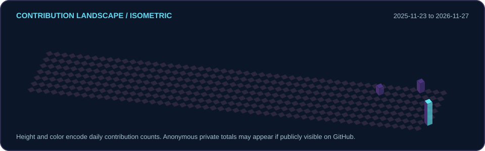

  

  <h3>Design systems. Build products. Make intelligence useful.</h3>

  
  
  

---

## 01 / About me

I'm **Parsa Afshar Fard**, a software developer and product builder exploring the intersection of intelligent systems, software engineering and real-world product development.

I like turning ambitious ideas into working systems: defining a problem, designing the architecture, building the product, and validating the result. My current work spans AI-assisted education, governed multi-agent workflows, local voice interfaces and engineering automation.

> Build with purpose. Validate with evidence. Keep improving.

## 02 / Public engineering dashboard

This panel is generated from the sanitized public metadata in the [Engineering Showcase](https://github.com/parasaf1/engineering-showcase). It highlights only the public, verified context I intentionally publish.

## 03 / Systems I'm building

<table>
<tr>
<td width="50%" valign="top">

<h3>LearnAva / Zabanyar</h3>
An AI-assisted German-learning and exam-preparation product built with Flutter and FastAPI.
<ul>
<li>Cross-stack mobile and API development</li>
<li>Protected learner audio delivery</li>
<li>Multi-speaker exam audio and preparation workflows</li>
</ul>
<a href="https://github.com/parasaf1/engineering-showcase/blob/main/data/lernava.json">Public engineering evidence →</a>
 <a href="https://engineering-showcase-inky.vercel.app/projects/lernava">Read full case study →</a>
</td>
<td width="50%" valign="top">

<h3>Extera / AI Company</h3>
A governed multi-agent platform with a dedicated SEVERUS owner-assistant experience.
<ul>
<li>Policy-controlled inference and task workflows</li>
<li>Local Windows microphone capture and speech recognition</li>
<li>Authorization boundaries, auditability and regression testing</li>
</ul>
<a href="https://github.com/parasaf1/engineering-showcase/blob/main/data/ai-company.json">Public engineering evidence →</a>
 <a href="https://engineering-showcase-inky.vercel.app/projects/ai-company">Read full case study →</a>
</td>
</tr>
</table>

Both products are in active development. Proprietary implementation remains private; the public showcase documents selected, sanitized engineering evidence and verification boundaries.

## 04 / Architecture snapshots

<b>Extera / AI Company</b>

 

<b>LearnAva / Zabanyar</b>

 

## 05 / Technology landscape

**Application & API**

  

**Web & product engineering**

  

**Systems & delivery**

  

## 06 / Engineering principles

| Principle | In practice |
| :--- | :--- |
| **Product first** | Start with a meaningful problem, not a technology checklist. |
| **Governed intelligence** | Explicit permissions, scoped tools and accountable AI workflows. |
| **Privacy by design** | Separate public evidence from proprietary source and user data. |
| **Evidence over claims** | Distinguish tested capabilities from work in progress. |
| **Continuous improvement** | Build, measure, validate and iterate. |

## 07 / Activity & momentum

Refreshed daily through GitHub Actions. This card samples public events only, not total contributions or private development activity.

Statistics and streaks use the GitHub contribution calendar visible to the automation, not private repository contents. They cover the returned calendar window, not lifetime totals.

## 08 / Explore my work

- [**Engineering Showcase**](https://github.com/parasaf1/engineering-showcase) — public project documentation and evidence.
- [**Live portfolio**](https://engineering-showcase-inky.vercel.app/) — a closer look at the projects, technical decisions and case studies.
- [**Verification boundaries**](docs/engineering-evidence.md) — how I separate public evidence from private implementation.

  

---

  
  Built with curiosity, discipline and a bias toward execution.

