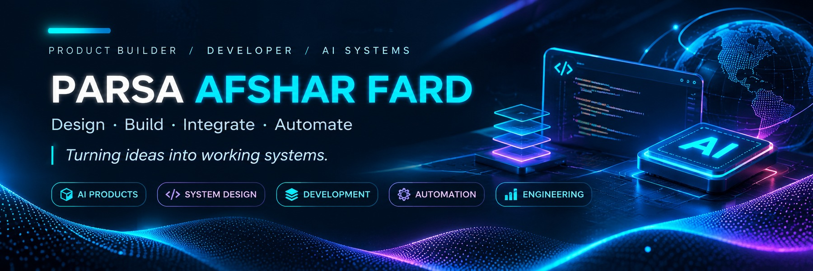
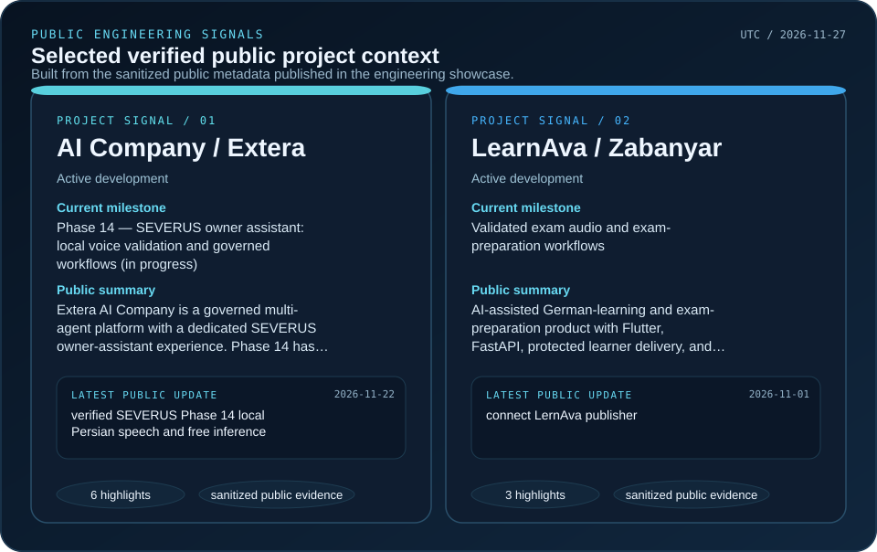
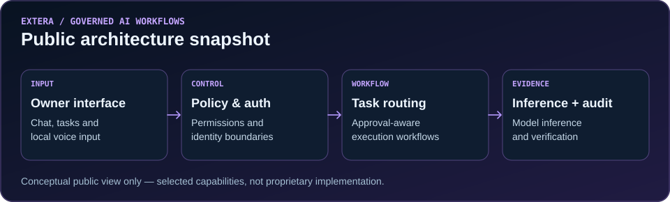
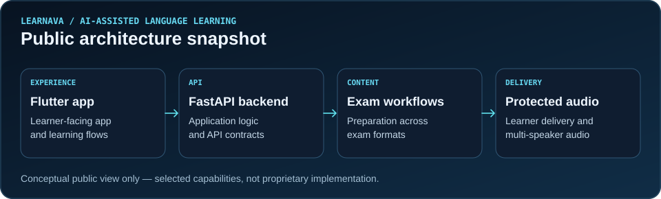
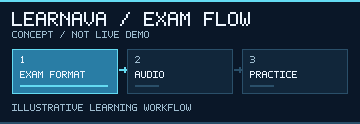
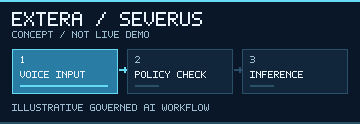
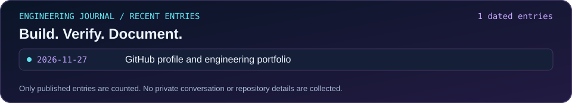

  

  <h3>Design systems. Build products. Make intelligence useful.</h3>

  

  
  
  

---

## 01 / About me

I'm **Parsa Afshar Fard**, a software developer and product builder exploring the intersection of intelligent systems, software engineering and real-world product development.

I like turning ambitious ideas into working systems: defining a problem, designing the architecture, building the product, and validating the result. My current work spans AI-assisted education, governed multi-agent workflows, local voice interfaces and engineering automation.

> Build with purpose. Validate with evidence. Keep improving.

**Start here:** [How I work](docs/profile-guide.md#engineering-approach) · [LearnAva project preview](docs/learnava-preview.md) · [Extera project preview](docs/extera-preview.md) · [How to read this profile](docs/profile-guide.md)

## 02 / Public engineering dashboard

This panel is generated from the sanitized public metadata in the [Engineering Showcase](https://github.com/parasaf1/engineering-showcase). It highlights only the public, verified context I intentionally publish. Each card summarizes the current milestone, documented highlights and latest published update; it is not a live production health monitor. [Understand the dashboard](docs/profile-guide.md#project-dashboard).

## 03 / Systems I'm building

<table>
<tr>
<td width="50%" valign="top">

<h3>LearnAva / Zabanyar</h3>
An AI-assisted German-learning and exam-preparation product built with Flutter and FastAPI.
<ul>
<li>Cross-stack mobile and API development</li>
<li>Protected learner audio delivery</li>
<li>Multi-speaker exam audio and preparation workflows</li>
</ul>
<a href="docs/learnava-preview.md"><b>Read project preview →</b></a>
 <a href="https://github.com/parasaf1/engineering-showcase/blob/main/projects/LEARNAva.md">Engineering evidence →</a>
 <a href="https://engineering-showcase-inky.vercel.app/projects/lernava">Read full case study →</a>
</td>
<td width="50%" valign="top">

<h3>Extera / AI Company</h3>
A governed multi-agent platform with a dedicated SEVERUS owner-assistant experience.
<ul>
<li>Policy-controlled inference and task workflows</li>
<li>Local Windows microphone capture and speech recognition</li>
<li>Authorization boundaries, auditability and regression testing</li>
</ul>
<a href="docs/extera-preview.md"><b>Read project preview →</b></a>
 <a href="https://github.com/parasaf1/engineering-showcase/blob/main/projects/AI_COMPANY.md">Engineering evidence →</a>
 <a href="https://engineering-showcase-inky.vercel.app/projects/ai-company">Read full case study →</a>
</td>
</tr>
</table>

Both products are in active development. Proprietary implementation remains private; the public showcase documents selected, sanitized engineering evidence and verification boundaries.

## 04 / Architecture snapshots

<b>Extera / AI Company</b>

 

The diagram illustrates how owner requests pass through authorization and policy, approval-aware task routing, and model inference with verification. The goal is useful automation without unrestricted authority. [Read the architecture and its limitations](docs/extera-preview.md#architecture).

<b>LearnAva / Zabanyar</b>

 

The diagram connects the Flutter learner experience to FastAPI services, exam workflows and protected audio delivery. The key concern is reliable, authorized content delivery rather than simply generating media. [Read the architecture and design decisions](docs/learnava-preview.md#architecture).

## 05 / Motion studies

The three slides introduce governed AI workflows, language-learning services and evidence-led development. [Read the showreel as text](docs/profile-guide.md#motion-studies).

[Explore Extera](https://engineering-showcase-inky.vercel.app/projects/ai-company) · [Explore LearnAva](https://engineering-showcase-inky.vercel.app/projects/lernava) · [Engineering journal](journal/README.md)

These short animated diagrams illustrate selected product concepts. They are **not recordings of working product interfaces**, and do not imply completed production readiness.

<b>Individual motion studies</b>

**LearnAva:** Exam format, audio and practice illustrate the connection between preparation requirements and the learner experience. [Read the motion preview](docs/learnava-preview.md#motion-preview).

**Extera:** Voice input, policy checks and inference illustrate the control boundaries of a governed assistant. [Read the motion preview](docs/extera-preview.md#motion-preview).

## 06 / Technology landscape

The tools below correspond to product capabilities rather than a list of claimed certifications. [Read how the stack fits together](docs/profile-guide.md#technology-landscape).

**Application & API**

  

**Web & product engineering**

  

**Systems & delivery**

  

## 07 / Engineering principles

| Principle | In practice |
| :--- | :--- |
| **Product first** | Start with a meaningful problem, not a technology checklist. |
| **Governed intelligence** | Explicit permissions, scoped tools and accountable AI workflows. |
| **Privacy by design** | Separate public evidence from proprietary source and user data. |
| **Evidence over claims** | Distinguish tested capabilities from work in progress. |
| **Continuous improvement** | Build, measure, validate and iterate. |

## 08 / Activity & momentum

Refreshed daily through GitHub Actions. This card samples public events only, not total contributions or private development activity.

Statistics and streaks use the GitHub contribution calendar visible to the automation, not private repository contents. They cover the returned calendar window, not lifetime totals.

The landscape uses height and color to encode contribution counts; the Snake animates the same general idea using GitHub contribution data. [Read what the colors, streaks and metrics mean](docs/profile-guide.md#activity-and-statistics).

## 09 / Explore my work

- [**Engineering Showcase**](https://github.com/parasaf1/engineering-showcase) — public project documentation and evidence.
- [**Live portfolio**](https://engineering-showcase-inky.vercel.app/) — a closer look at the projects, technical decisions and case studies.
- [**Daily Engineering Journal**](journal/README.md) — meaningful engineering outcomes and public verification.
- [**Verification boundaries**](docs/engineering-evidence.md) — how I separate public evidence from private implementation.

  

---

  
  Built with curiosity, discipline and a bias toward execution.

