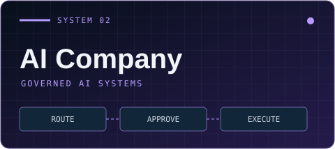
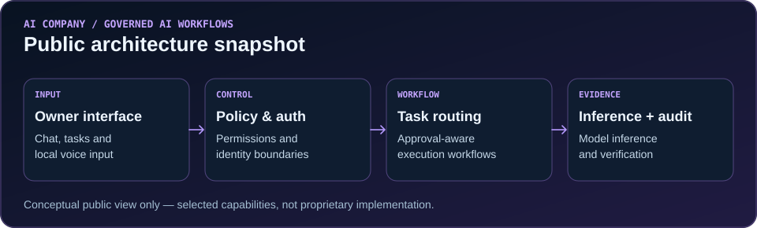
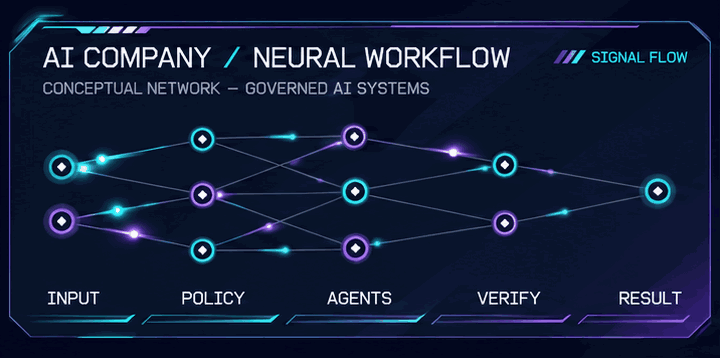
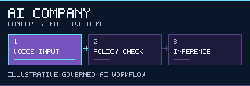

# AI Company — project preview

[Back to profile](../README.md) · [Full case study](https://engineering-showcase-inky.vercel.app/projects/ai-company) · [Public engineering evidence](https://github.com/parasaf1/engineering-showcase/blob/main/projects/AI_COMPANY.md)

## What is AI Company?

AI Company is a multi-agent AI platform designed around controlled execution, policy-owned model routing, persistent workflow state, approvals and verifiable outcomes. Its dedicated owner-assistant experience is part of the platform, not a claim of an independently operating AI company.

## Problem and product goal

Useful AI agents must coordinate tasks without losing control of permissions, product context, execution state or evidence. The goal is to separate task intent from the authority to execute and to make failures, approvals and results traceable.

## My role

System designer and implementing engineer: platform decomposition, runtime boundaries, integration, routing and verification. The public case study describes work on a supervisor, agent registry, capability-oriented intake, isolated execution, persistent tasks, recovery, events and memory interfaces.

## Architecture

| Layer | Responsibility |
| --- | --- |
| Owner interface | Express task intent through owner conversations or explicit local voice input. |
| Policy and authorization | Apply scoped identity and permission boundaries; determine required approval. |
| Workflow coordination | Route tasks, maintain state and coordinate approval-aware execution and recovery. |
| Inference and evidence | Select permitted model routes, record attempts and verify results. |

This is a conceptual public map, not a disclosure of runtime internals or a claim that every path is production-ready. The public design separates provider routing, execution, memory and event capabilities.

## Engineering decisions

- Keep model selection policy-owned and separate from task intent.
- Require scoped authorization and approvals at privileged boundaries.
- Persist workflow state and define recovery paths.
- Use events, structured attempts and verification to explain execution outcomes.

## Motion preview

This conceptual network visualizes the flow of a request through input, policy checks, agent coordination, verification and results. The moving pulses are illustrative, not real-time telemetry, model weights or a disclosure of the internal system topology.

**What the three frames mean:** voice input represents explicit local microphone capture; policy check represents the control boundary between a request and permitted action; inference represents a permitted model execution path. This animation illustrates a design concept. It does not demonstrate a complete voice conversation or autonomous multi-agent mission.

## What has been verified?

The public metadata dated 22 November 2026 records Phase 14 development-branch evidence:

- Opt-in public free-model inference and local Windows microphone capture.
- Offline Persian speech-to-text observed on real hardware, with accuracy/latency trade-offs.
- Hash-verified model installation, language-scoped selection and reproducible diagnostics.
- 1,315 offline regression tests passed on Linux and a successful Windows integration suite, as reported in the public source.

The same source reports roughly 19–23 seconds of CPU processing for a ten-second Persian speech sample in measured trials. These are historical observations, not guaranteed performance or a new independent benchmark.

## Current status and release boundaries

**Active development; Phase 14 evidence is on a development branch.** The public source does not establish completed spoken replies, full voice conversation, independently verified end-to-end multi-agent missions, business-source coverage, consented integrations, continuous operation or production release.

Read [current project metadata](https://github.com/parasaf1/engineering-showcase/blob/main/data/ai-company.json) for updates. No private source, prompts, API credentials, memory or customer data are exposed. Real product recordings are not yet included.

## Explore further

[Full website case study](https://engineering-showcase-inky.vercel.app/projects/ai-company) · [Detailed GitHub case study](https://github.com/parasaf1/engineering-showcase/blob/main/projects/AI_COMPANY.md) · [Evidence boundaries](engineering-evidence.md)
