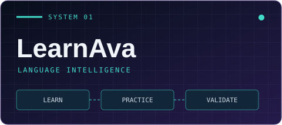
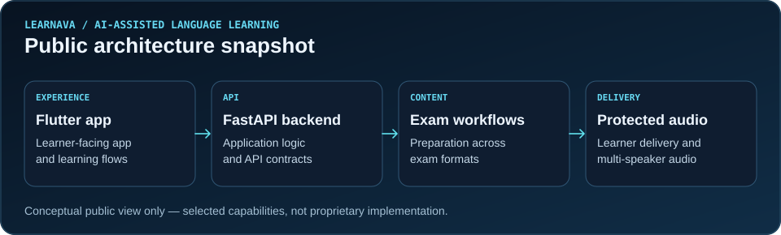
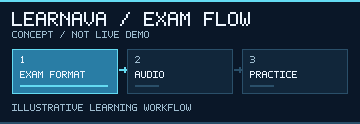

# LearnAva — project preview

[Back to profile](../README.md) · [Full case study](https://engineering-showcase-inky.vercel.app/projects/lernava) · [Public engineering evidence](https://github.com/parasaf1/engineering-showcase/blob/main/projects/LEARNAva.md)

## What is LearnAva?

LearnAva is a Persian-first German-learning and exam-preparation product. It connects a Flutter client to modular FastAPI services and embeds AI-assisted capabilities in learner workflows rather than presenting AI as a separate demonstration.

## Problem and product goal

The engineering challenge is to connect identity, speaking practice, exam preparation and generated learning media into a coherent learner experience. The product must keep client and server contracts aligned and ensure learner content is delivered only through authorized workflows.

## My role

Product builder and cross-stack engineer: requirements, architecture, implementation coordination, API integration, debugging and validation. Public case-study evidence describes work on onboarding, authentication, speaking practice, exam packs, billing contracts and protected media delivery.

## Architecture

| Layer | Responsibility |
| --- | --- |
| Flutter / Dart | Learner-facing flows, interface state and calls to authenticated services. |
| FastAPI / Python | Application logic and REST contracts for learning capabilities. |
| Exam workflows | Organize preparation around supported exam formats and reusable flows. |
| Protected media | Ownership-aware delivery, multi-speaker audio and quality checks. |

The diagram is a simplified capability map. The public case study describes feature-oriented client modules, backend presentation/application/domain/infrastructure concerns where useful, and provider gateways. It does not disclose proprietary endpoints, data schemas or implementation details.

## Engineering decisions

- Separate product capabilities to keep client and service changes manageable.
- Treat generated audio as an artifact that needs quality validation, not as automatically correct provider output.
- Require authenticated delivery and ownership checks for protected learner audio.
- Validate feature behavior with automated tests and integration debugging.

## Motion preview

**What the three frames mean:** exam format identifies the preparation context; audio represents the protected multi-speaker media workflow; practice represents the learner-facing activities that use those capabilities. This is an illustrative flow, not a recorded UI or a literal sequence of internal calls.

## What has been verified?

The public milestone records validated exam audio and exam-preparation workflows. The case study documents test coverage for identity/session flows, conversations, exam packs, billing contracts, protected audio, media rejection/regeneration and health behavior. No complete production rollout or user-adoption claim is made here.

## Current status and next focus

**Active development** — strengthening exam-oriented workflows, media quality and end-to-end learner reliability. The current public status is maintained in [project metadata](https://github.com/parasaf1/engineering-showcase/blob/main/data/lernava.json).

Real product screenshots and recordings are not yet included in this profile. Source code, prompts, content and user data remain private.

## Explore further

[Full website case study](https://engineering-showcase-inky.vercel.app/projects/lernava) · [Detailed GitHub case study](https://github.com/parasaf1/engineering-showcase/blob/main/projects/LEARNAva.md) · [Evidence boundaries](engineering-evidence.md)
