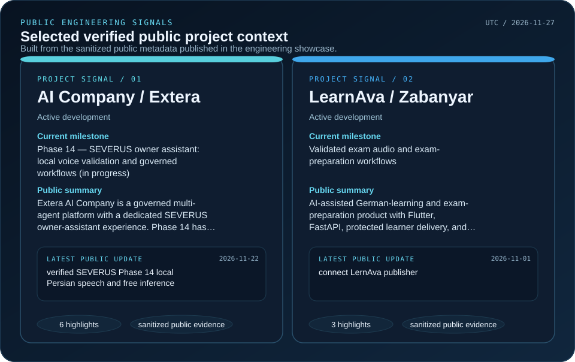
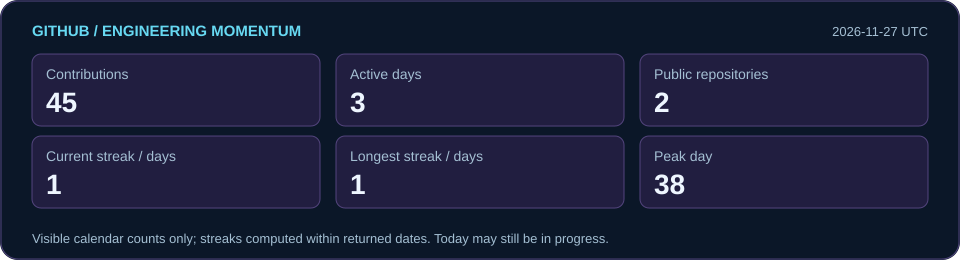
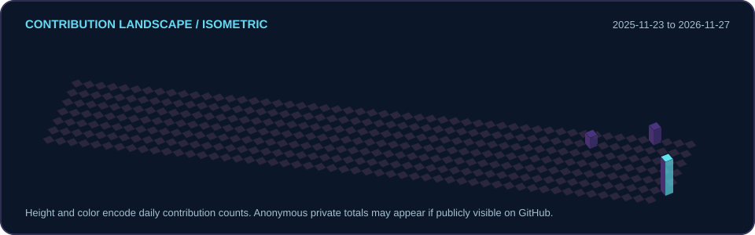

# Engineering profile — reader's guide

[Back to the profile](../README.md) · [Live portfolio](https://engineering-showcase-inky.vercel.app/)

## Start here

I'm Parsa Afshar Fard, a product builder and software developer working across client applications, backend services and AI systems. This profile is an engineering showcase rather than a collection of decorative badges. Its two main case studies are LearnAva, an AI-assisted language-learning product, and Extera, a governed multi-agent platform with a SEVERUS owner-assistant experience.

| If you want to understand… | Read |
| --- | --- |
| Learning product, API and protected media | [LearnAva preview](learnava-preview.md) |
| Agent governance, routing and local voice | [Extera preview](extera-preview.md) |
| Engineering process and design decisions | [Engineering approach](#engineering-approach) |
| What has actually been verified | [Evidence boundaries](engineering-evidence.md) |
| Recent work | [Daily engineering journal](../journal/README.md) |

## Engineering approach

The animated console is an introduction to my role and work, not a running terminal. Think, build, verify and evolve describe the development loop:

1. **Think:** identify the product problem, constraints, interface boundaries and intended outcome.
2. **Build:** deliver the smallest useful implementation across the relevant client, API or runtime layers.
3. **Verify:** examine test results, integration behavior and failures; distinguish a successful check from production readiness.
4. **Evolve:** improve the next iteration using evidence, not feature counts alone.

LearnAva applies this loop to exam-oriented learning and media delivery. Extera applies it to authorization, reliable task coordination and model execution. The two systems have different goals but share an emphasis on explicit boundaries and verifiable outcomes.

## Project dashboard

The dashboard is generated from published, sanitized project metadata. Each card displays development status, current milestone, public summary, selected recent update and the count of published highlights. A milestone can be in progress; a highlight count is a documentation count, not a feature completion percentage. The UTC date marks the generated snapshot, not an independent audit.

Read the current [LearnAva metadata](https://github.com/parasaf1/engineering-showcase/blob/main/data/lernava.json) or [Extera metadata](https://github.com/parasaf1/engineering-showcase/blob/main/data/ai-company.json) for the exact source and verification boundaries. The [case studies](https://engineering-showcase-inky.vercel.app/#projects) supply narrative context.

## Motion studies

The showreel is a rotating conceptual introduction, not a screen recording. Its three frames mean:

- **Extera / SEVERUS:** an owner request or voice input encounters policy and approval boundaries before inference and verification. [Read the full explanation](extera-preview.md#motion-preview).
- **LearnAva:** Flutter and FastAPI connect exam requirements with learner-facing practice and audio workflows. [Read the full explanation](learnava-preview.md#motion-preview).
- **Engineering Journal:** the design–validation–documentation loop is a way of maintaining public evidence over time. [Read the journal](../journal/README.md).

The text remains available even if animation is disabled, a browser displays only the first frame, or GitHub's image preview behaves differently from the README.

## Technology landscape

Flutter and Dart support the learner-facing mobile application; Python and FastAPI support authenticated application services. Next.js, React and TypeScript form the public portfolio's web implementation. Docker-based local development, Git and automated tests support repeatable engineering work. GitHub Actions regenerates public profile graphics from permitted sources. Windows is the environment used for the documented local speech tests.

These are contextual descriptions of the stack, not claims that every technology is used in every project or that I hold a particular certification.

## Activity and statistics

The recent public activity panel samples public GitHub events over its labeled window. This is separate from the contribution calendar and should not be added to the contribution total. The statistics card uses dates and counts from the GitHub contribution calendar visible to the automation.

- **Contributions:** sum of returned daily contribution counts.
- **Active days:** dates with a nonzero count.
- **Public repositories:** public repositories owned by the account as returned by GitHub.
- **Current streak:** consecutive active dates ending today, or yesterday if today is not yet active.
- **Longest streak:** longest consecutive sequence within the returned window.
- **Peak day:** largest daily contribution count in that window.

These are not lifetime metrics or measures of productivity. Private activity may not be represented; a GitHub contribution is not necessarily a code commit. The cards refresh through [GitHub Actions](https://github.com/parasaf1/parasaf1/actions) and can be stale between successful runs.

## Contribution calendar

Dark cells represent dates with zero observed contributions. Violet and cyan encode increasing activity; taller bars represent larger counts relative to the maximum observed in the calendar window. The individual date and count are included in the SVG's descriptive elements where the viewer exposes them.

The Snake is a generated animation of contribution data using Platane's open-source project. It is visual decoration, not another source of activity, and does not create contributions. The native GitHub calendar remains the authoritative account display. Daily journal entries record real engineering work rather than artificial activity.

## Where to go next

[LearnAva](learnava-preview.md) · [Extera / SEVERUS](extera-preview.md) · [Daily journal](../journal/README.md) · [Public evidence](engineering-evidence.md) · [Portfolio](https://engineering-showcase-inky.vercel.app/)
