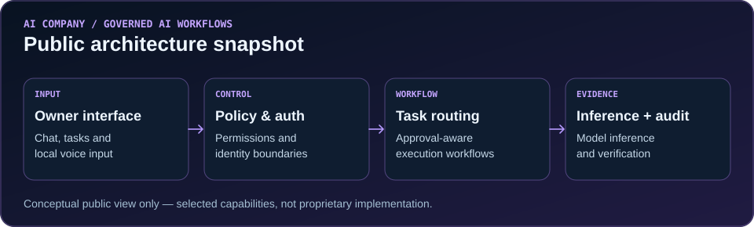

# EXTERA — AI Company

[Official GitHub Project](https://github.com/users/parasaf1/projects/1) · [All public roadmaps](README.md) · [Project preview](../docs/ai-company-preview.md) · [Engineering case study](https://github.com/parasaf1/engineering-showcase/blob/main/projects/AI_COMPANY.md) · [Portfolio](https://engineering-showcase-inky.vercel.app/projects/ai-company)

**Product objective:** Coordinate AI-assisted tasks through a governed multi-agent platform, with a dedicated owner assistant, policy-controlled model routing, scoped authorization, durable workflow state and verifiable outcomes.

**Status:** Active development. The latest cited public milestone describes Phase 14 owner-assistant development-branch evidence, dated November 22, 2026. No production release or complete autonomous operation is claimed.

## Workstreams

| Area | Focus |
| --- | --- |
| Multi-agent architecture | Supervisor, coordination, task state and recovery. |
| SEVERUS personal assistant | Owner-facing interaction and governed requests. |
| Local voice intelligence | Explicit local capture, speech recognition and eventual validated spoken replies. |
| AI governance and security | Scoped authorization, approvals and privacy boundaries. |
| Model orchestration | Policy-owned model selection, provider routing and validation. |
| Testing and automation | Regression suites, integration checks and execution evidence. |

## Public delivery board

| Stage | Public scope / proposed next work | Evidence or gate |
| --- | --- | --- |
| Backlog | Candidate longer-running operation and consented business integrations | Validate scope, consent and operational safeguards first. |
| Planned | Proposed next gate: validate spoken replies and full voice conversation | No completed conversational voice capability claimed. |
| In Progress | Phase 14 owner-assistant and governed workflows | Public Phase 14 milestone describes ongoing development. |
| Testing | End-to-end independently verified multi-agent missions and release readiness | Verification gates remain open; this is not a claim that testing is currently running. |
| Completed | Opt-in free-model inference; explicit local microphone capture; offline Persian speech recognition; development-branch regression evidence | Scoped observations reported in the public case study. |
| Released | No production release established by the cited evidence | Requires explicit release evidence. |

## Release criteria

- Validate scoped authorization, approvals and failure/recovery behavior.
- Demonstrate independently verifiable end-to-end missions and complete voice interaction for the claimed scope.
- Establish consent and source provenance for any external integrations.
- Record supported release scope and test evidence without exposing private implementation.

[Current public metadata](https://github.com/parasaf1/engineering-showcase/blob/main/data/ai-company.json) · [Evidence boundaries](../docs/engineering-evidence.md)

This roadmap is a sanitized planning view. Planned items and gates do not imply implementation, delivery dates or current runtime availability.
