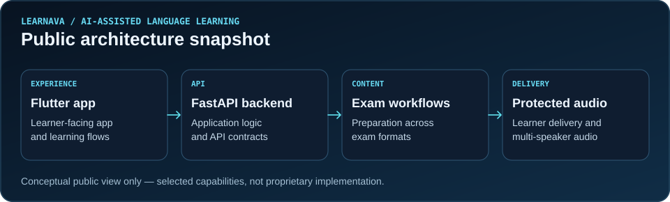

# LearnAva

[Official GitHub Project](https://github.com/users/parasaf1/projects/2) · [All public roadmaps](README.md) · [Project preview](../docs/learnava-preview.md) · [Engineering case study](https://github.com/parasaf1/engineering-showcase/blob/main/projects/LEARNAva.md) · [Portfolio](https://engineering-showcase-inky.vercel.app/projects/lernava)

**Product objective:** Connect Persian-first German language learning, speaking practice and exam preparation through a maintainable Flutter client and modular FastAPI services, with authorized learner media delivery.

**Status:** Active development. The public milestone documents validated exam audio and exam-preparation workflows; it does not establish a complete production rollout or user adoption.

## Workstreams

| Area | Focus |
| --- | --- |
| Flutter mobile application | Onboarding, learner flows and client state. |
| FastAPI backend | Modular services, identity and authenticated API contracts. |
| AI language tutor | AI-assisted speaking and learning workflows. |
| German exam preparation | Reusable exam-oriented preparation flows. |
| Audio and conversation systems | Quality-gated multi-speaker media and protected delivery. |
| Testing and deployment | Cross-stack regression, integration and release validation. |

## Public delivery board

| Stage | Public scope / proposed next work | Evidence or gate |
| --- | --- | --- |
| Backlog | Candidate refinements to learner experience and preparation coverage | Prioritize using validated needs and feasibility. |
| Planned | Proposed next gate: strengthen end-to-end learner-journey reliability | Define and verify representative learner scenarios. |
| In Progress | Exam-oriented learning workflows, media quality and cross-stack reliability | Public engineering focus identifies these ongoing areas. |
| Testing | Proposed release gates: authenticated delivery, media quality, client/API compatibility and regression coverage | Revalidate the intended release scope; no live test run claimed. |
| Completed | Validated preparation flows across multiple German exam formats; protected learner audio and multi-speaker exam audio | Scoped public milestone and case-study evidence. |
| Released | No complete production rollout established by the cited evidence | Requires explicit release evidence. |

## Release criteria

- Validate authenticated learner workflows and ownership-aware media access.
- Confirm generated audio quality and rejection/regeneration behavior.
- Verify client/API contracts and relevant end-to-end journeys.
- Record deployment scope and regression evidence without disclosing proprietary code or learner data.

[Current public metadata](https://github.com/parasaf1/engineering-showcase/blob/main/data/lernava.json) · [Evidence boundaries](../docs/engineering-evidence.md)

This roadmap is a sanitized planning view. Planned items and gates do not imply implementation, delivery dates or current runtime availability.
